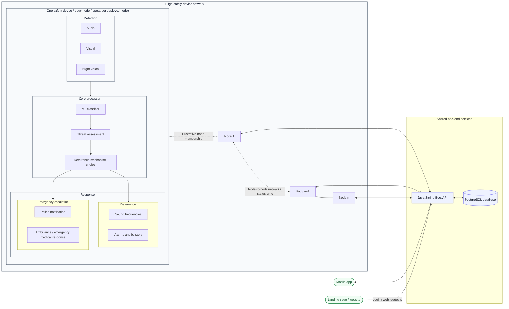

# SIP — Master Context

**Problem statement / project title:** An AI-Powered Safety Device  
**System name:** SIP Guardian  
**Project owner / team lead:** B C H Benjamin  
**Institution:** Atria Institute of Technology, Bengaluru, Karnataka, India  
**Repository:** https://github.com/bchbenjamin/SIP  
**Context reviewed:** 22 October 2026  
**Current repository branch reviewed:** `main`

> This file is the concise, current entry point for future development and for Benjamin's academic reference. It separates repository evidence from planned capabilities and unverified deployment/device state. Historical academic material is summarized in the appendix; detailed runbooks remain in their dedicated documents. Never place secrets or live credentials here.

---

## 1. Project identity and purpose

SIP is a multi-semester academic and engineering project developing **An AI-Powered Safety Device**: an AI-assisted safety device network. The intended system uses edge-based sensing and classification to identify potentially dangerous events, notify human operators, and support proportionate responses. Motivating use cases include weapon-related threats, violence, suspicious activity, accidents, and wildlife encounters in poorly monitored or isolated areas.

The current problem statement is **“An AI-Powered Safety Device.”** “Two-Wheeler Visibility Crisis” is an obsolete working title and must not be used as the current problem statement. Historical research notes, field-visit records, and literature-survey material are retained as academic reference in this document's appendix.

### Design principles

- Perform inference locally on the edge device where practical; cloud connectivity must not be a prerequisite for local detection.
- Treat the Spring Boot backend as the shared API, authentication, persistence, event-delivery, and command/control layer—not as the edge inference engine.
- Treat Neon PostgreSQL as the intended cloud system of record. Android and the Pi must not connect directly to the database.
- Distinguish model predictions from human verification. Preserve the original prediction and audit changes.
- Make incident ingestion idempotent and tolerate network interruption through durable local queuing and bounded retries.
- Do not describe the system as a replacement for emergency services or as production-grade life-safety equipment. It is a research prototype; false positives, missed detections, network outages, and hardware failures remain possible.
- Autonomous deterrence must be proportionate, configurable, and safe. Do not claim police/emergency-service integration or multi-node mesh resilience unless the specific implementation has been built and tested.

## 2. Current repository and canonical source of truth

The unified repository is the source of truth for new cross-component development:

**https://github.com/bchbenjamin/SIP**

Current top-level layout observed on `main`:

```text
SIP/
├── android-frontend/
│   ├── android/                 # Android application
│   ├── backend/                 # Deprecated backend copy; do not develop here
│   ├── CONTEXT/                 # Project context and implementation-plan material
│   └── docs/                    # Android/backend status and planning docs
├── database/
│   ├── backend/                 # Canonical Spring Boot backend
│   └── docs/                    # API, deployment and Pi integration docs
├── landing-page/                # Landing page in this monorepo
├── node-backend/
│   └── pi/                      # Raspberry Pi / edge-AI scripts and configuration
├── releases/                    # Checked-in debug APK artifact
├── Dockerfile
├── render.yaml
├── .env.example
└── release-notes-v0.2.0-beta.1.md
```

Use repository-relative paths. Do not assume an absolute workstation path or copy old paths from historic notes without checking the current tree.

### Canonical component ownership

| Component | Canonical location | Role |
|---|---|---|
| Android app | `android-frontend/android/` | Operator-facing mobile client |
| Shared API/backend | `database/backend/` | REST API, authentication, persistence, incident lifecycle, MQTT bridge and WebSocket delivery |
| Raspberry Pi edge software | `node-backend/pi/` | Local inference, training/data tools, event queue, device communication and monitoring scripts |
| Landing page | `landing-page/` | Public project website in this repository |
| Backend integration/deployment docs | `database/docs/` | API, deployment and Pi integration guides |
| Edge run/setup docs | `node-backend/RUN_GUIDE.md`, `node-backend/RASPBERRY_PI_SETUP.md` | Operational procedures; verify current commands before use |
| Android implementation status | `android-frontend/docs/IMPLEMENTATION_STATUS.md` | Detailed component status; reconcile against code and tests |

**Do not use `android-frontend/backend/` for new backend development.** Its README marks it deprecated and identifies `database/backend/` as canonical. Older repositories such as `SIP-Android` and `SIP-4th-sem` are historical origins, not the default place for new cross-component changes. The landing page is now present under `landing-page/`; older notes that treat `sip-dashboard` as the canonical separate landing-page repository are superseded unless the owner explicitly changes that decision.

## 3. Master architecture

This is the current **high-level architecture plan**, not a final implementation specification. It is deliberately modular: expand individual subgraphs as the design matures, while keeping this master diagram readable. The physical node is repeated across the network; “Node 1”, “Node n−1”, and “Node n” are illustrative, not a fixed deployment count.



**Reading the diagram**

- Each physical node is intended to perform detection, classification, threat assessment, and a response-selection step locally.
- The response path branches into deterrence (sound frequencies, alarms/buzzers) and emergency escalation (police and emergency medical response). These are planned response categories; do not imply a live emergency-service integration unless it has been specifically implemented and verified.
- Multiple edge nodes form the intended network. The drawing does not claim that mesh failover or automatic neighbour reconfiguration is already implemented.
- The Java Spring Boot service is the shared application/API layer; PostgreSQL is its data store. The mobile app and landing page communicate with the backend rather than connecting directly to the database.
- Exact protocols, authentication, node discovery, network topology, and message contracts belong in component-level diagrams and integration documentation as they are finalized.

The earlier text-only diagram below is superseded by this Mermaid master diagram. Keep the master view high-level; add detailed Mermaid subgraphs in the relevant component documentation rather than turning this into an unreadable mega-diagram.

### Android

The app is located at `android-frontend/android/`. The inspected codebase uses Java for domain/data components and Kotlin with Jetpack Compose for UI, alongside Room local persistence, Retrofit/OkHttp networking, encrypted token storage, authentication/token refresh, and WebSocket client handling. Confirm exact module/build configuration from Gradle before changing versions, package names, build variants, or release settings.

### Backend and database

The canonical backend is `database/backend/`, a Spring Boot 3 / Java 17 application. The repository includes REST controllers and service layers for authentication, incidents, nodes, and commands; JWT-based security; PostgreSQL persistence; Flyway migrations; WebSocket support; and MQTT integration code. Flyway migration files observed range from V1 through V8.

The Android app and Pi communicate with the backend. They must never contain or use the database's credentials. Keep large evidence binaries in appropriate object storage if/when that integration is implemented; store references and metadata in the database rather than assuming binary evidence storage is already available.

### Raspberry Pi / edge AI

The main edge code is under `node-backend/pi/`. Relevant files include:

- `edge_server.py` — edge inference/service entry point.
- `train_autonomous.py` — training orchestration and checkpoint handling.
- `download_and_merge.py` — dataset download/merge pipeline.
- `dataset_registry.py`, `dataset_audit.py` — dataset tracking and auditing.
- `backend_sync.py`, `mqtt_client.py`, `event_queue.py` — backend communication and queued events.
- `app_batch.py` and related scripts — offline/batch processing.
- `telegram_bot.py`, `telegram_notify.py` — remote monitoring and inference helper scripts.
- `.env.example`, `config.json`, and systemd unit files — configuration templates and service definitions.

Scripts may refer to runtime paths such as `~/edge-ai`; verify the actual Pi checkout and service configuration before running or editing commands. The repository cannot prove which model checkpoint, dataset, services, or configuration are currently active on the physical Pi.

## 4. Implementation status — strict evidence labels

Status labels in this context mean:

- **Present in source:** the relevant implementation/configuration exists in the repository.
- **Automated-test verified:** the relevant tests passed for the stated revision; include the command and revision when recording this.
- **Deployed:** the component is installed at the stated service/environment and the deployment revision is known.
- **End-to-end verified:** a real test exercised the complete relevant flow across components.
- **Planned / unverified:** described by design documents, comments, or prior reports but not confirmed by current test evidence.

Do not upgrade a status label based only on a README, a successful compile, an HTTP liveness response, or a class existing in source.

### Repository observations from 22 October 2026

| Area | Evidence-based status | Notes |
|---|---|---|
| Android app structure and API/WebSocket client code | Present in source | Device-level end-to-end behaviour was not tested during this context review. |
| Spring Boot backend | Present in source | Production database connectivity and complete workflows require separate verification. |
| Database migrations | Present in source, V1–V8 | Verify migration success against the actual target database before calling it deployed/healthy. |
| Incident REST ingestion | Present in source | Requires authenticated, persisted end-to-end smoke test. |
| Node registration and heartbeat REST endpoint | Present in source | Endpoint presence does not prove the Pi is sending valid heartbeats. |
| MQTT incident handling | Present in source | Handler has an incident ingestion path. Confirm broker, TLS, credentials, topic ACLs, and end-to-end persistence. |
| MQTT heartbeat handling | Incomplete in inspected code | `MqttMessageHandler.handleHeartbeatMessage` currently logs the message; persistence/status update is marked TODO. |
| MQTT command acknowledgement / rejection | Incomplete in inspected code | Inspected handlers log ACK/NACK messages; updating command state is marked TODO. |
| Command queue REST APIs | Present in source | Verify authorization, delivery, acknowledgement, expiry and retry semantics end to end. |
| Dataset registry/audit/training scripts | Present in source | Current Pi dataset/checkpoint/metrics were not queried during this review. |
| Landing page | Present in repository | Live Vercel deployment and DNS were not verified in this review. |
| Render backend health checks | Configuration/commits present | A liveness endpoint is not a database or end-to-end health check. |
| GitHub release | Published prerelease metadata observed | See release section below; not a claim of production readiness. |

### Immediate engineering priorities

1. Complete MQTT heartbeat persistence and node-status updates.
2. Complete MQTT command ACK/NACK persistence and validate command ownership, state transitions, expiry, and idempotency.
3. Add/verify automated tests for Pi authentication, incident idempotency, incident lifecycle, command authorization, and offline/retry behaviour.
4. Verify backend deployment revision, Neon connectivity, Flyway status, and database-backed smoke tests.
5. Verify Pi-to-backend event ingestion and Android live incident delivery as end-to-end flows.
6. Verify the landing page deployment and its public configuration.
7. Audit tracked files and Git history for credentials and personal operational data; rotate any real credentials found committed.
8. Reconcile old implementation-status and setup documents with the current source tree.

## 5. API and integration contracts

Use `database/docs/API.md` and `database/docs/PI_INTEGRATION.md` as detailed contract references, but compare them with current controller/DTO/service code before making changes.

Observed backend routes include:

- `/api/v1/incidents` — incident ingestion and incident listing/detail flows.
- `/api/v1/nodes` — node management and registration.
- `/api/v1/nodes/{id}/heartbeat` — REST heartbeat.
- `/api/v1/commands` — command dispatch and query/acknowledgement flows.
- Authentication endpoints under `/api/v1/auth/`.
- WebSocket endpoint paths under `/ws/**`.

These are route families, not a complete API specification. Confirm request DTOs, response schemas, authentication filters, roles, and status transitions in source before relying on a specific contract. Do not assume every Pi-facing endpoint uses the same authentication mechanism; verify the filter/service applied to the route.

MQTT topic patterns observed in the backend message handler include `sip/{nodeId}/incidents`, `sip/{nodeId}/heartbeat`, `sip/{nodeId}/command/ack`, and `sip/{nodeId}/command/nack`. Check the Pi publisher/client and broker ACL configuration for exact topic symmetry. MQTT must use authenticated TLS in a production-like setup; a public unauthenticated broker is not acceptable for commands or sensitive incident traffic.

## 6. Deployment and release facts

### Backend

Repository configuration includes a root `Dockerfile` and `render.yaml`. The intended service uses Render and Neon PostgreSQL. The intended public API hostname documented by the project is `https://api.sip.bchbenjamin.in/`; the GitHub release notes also mention this URL. Treat this as a configured/intended hostname, **not proof that DNS, TLS, routing, database access, or application workflows are currently healthy**. Verify those separately before a release.

Recent commits on 16 October 2026 addressed Render startup/health-check behaviour, including the database-pool check and health endpoint configuration. Inspect the active service settings and deployed commit before revisiting deployment configuration. A successful liveness response must not be treated as proof that Neon queries or authenticated application routes work.

### Android release

GitHub Releases contains the prerelease **SIP Guardian v0.2.0 Beta** (`v0.2.0-beta.1`), published on 10 October 2026, with asset `sip-guardian-v0.2.0-beta.1.apk`. The release metadata reports package `com.sip.guardian`, version 0.2.0 / versionCode 2, min SDK 26, target SDK 35, a self-signed beta key, and SHA-256:

`86c77e25f17e09f30e5f6bd5812e05890b7e1c7fae37cef5677858815c75b50b`

Release notes explicitly classify this as beta/research software, state there is no real police/emergency-service integration, and warn of false positives, missed detections, and possible WebSocket reconnection issues after backend sleep. Verify the downloaded artifact's checksum and current build configuration before redistributing it.

A separate checked-in artifact exists at `releases/sip-guardian-debug-latest.apk`; do not confuse it with the release APK. The existence of either artifact does not prove that the latest source builds reproducibly or that the deployment currently works.

### Landing page

The landing page source is in `landing-page/` and includes its own README and Vercel configuration. Treat it as part of the monorepo. Do not assume its production URL, DNS, build status, or deployed revision without checking the Vercel project and a live deployment.

## 7. AI, datasets, and model evaluation

The repository contains YOLO-oriented edge detection and training/data pipeline code. Older academic notes describe a weapon dataset assembled from multiple sources, an action-recognition dataset, audio/scream datasets, wildlife datasets, and proposed parallel behaviour/audio classifiers. These are **research leads and historical pipeline notes**, not evidence that every dataset is currently merged, licensed for the intended use, available on the Pi, or included in the active training run.

For current dataset and model state:

1. Inspect the current Pi filesystem and the exact training process/checkpoint.
2. Run the repository's dataset registry/audit tools and inspect the generated manifest/logs.
3. Record dataset version, source, licence, split, class counts, label format, duplicates/leakage checks, and transformation steps.
4. Record the model architecture/weights hash, training configuration, validation split, per-class precision/recall, mAP where applicable, confusion matrix, and false-positive/false-negative examples.
5. Never hardcode old image counts or training metrics as current. Date and label all measured results.
6. Do not treat a folder-per-class image classification dataset as YOLO bounding-box data without an explicit, validated conversion or a separate classifier.
7. Do not claim continuous/self-healing training is reliable until restart/resume, low-memory behaviour, dataset failure handling, and checkpoint recovery have been tested.

Potential audio, human-action, and wildlife detection are documented research directions. Do not state they are integrated into the active real-time inference path unless the current code and a test demonstrate that integration.

## 8. Security, privacy, and safety requirements

- Never commit `.env` files, passwords, access tokens, private keys, JWT signing secrets, database URLs with credentials, device API keys, MQTT credentials, Telegram bot tokens, SSH passwords, or private operational identifiers.
- Commit only safe templates such as `.env.example`, with placeholder values. Check whether secrets were already tracked; `.gitignore` does not remove a secret from Git history.
- If a real credential was committed or exposed, rotate/revoke it first. Consider history cleanup when appropriate, without mistaking history rewriting for credential rotation.
- Do not put secrets in the APK, landing page's public build variables, logs, issues, commit messages, or this context.
- Use per-device credentials, authenticated TLS MQTT, restrictive topic ACLs, narrow CORS allowlists, and role-based authorization. CORS is not authentication.
- Preserve human verification and an audit trail for consequential incident decisions. Do not silently overwrite model predictions with human labels.
- Do not send automated reports to real police/emergency services or activate physical deterrents during tests without explicit authorization and a controlled test plan.
- Do not present the research prototype as a guaranteed crime-prevention, emergency-response, or life-safety product.

## 9. Hardware and operational constraints

The project's target edge platform is a **Raspberry Pi 5 with 4 GB RAM**, as recorded in the project design. The Pi is intended to perform local inference and maintain event queues during network outages. Actual hardware availability, OS version, IP address, storage headroom, running services, model weights, and training state must be checked on the device before operational work.

Never assume a historic IP address, SSH target, absolute path, active systemd unit, or long-running training job is still current. Before system-level changes:

1. Verify device identity and current repository revision.
2. Record active services, memory/disk usage, model/checkpoint paths and training process.
3. Back up configuration and valuable checkpoints before migration.
4. Avoid deleting datasets/checkpoints or interrupting long training without a clear reason.
5. Use the maintained Pi setup/run guides and confirm each command matches the current tree.

## 10. Academic and institutional reference

- **Programme:** B.E. Computer Science Engineering.
- **Institution:** Atria Institute of Technology, Bengaluru.
- **Project/course:** ASIP — Atria's Societal Impactful Project, intended as a multi-semester project spanning Semesters 3–8.
- **Project identifiers recorded in academic material:** older ASIP ID `ASIP_127` (which is still sometimes used cuz these idiots in my college keep mixing things up); later ID `24UTAI13`. Verify which identifier the current college form/report requires.
- **Current problem statement:** “An AI-Powered Safety Device.”
- **Research paper format recorded in the project notes:** six pages, double-column IEEE style. Re-check the current submission requirements before preparing a final manuscript.
- **Development model selected in the academic design:** incremental development, allowing separately testable increments over multiple semesters.
- **Primary social objective:** improve awareness and response to safety incidents in poorly monitored public areas.
- **SDG alignment recorded in the original project materials:** SDG 12 (described there as law enforcement/governance), SDG 6 (emergency/disaster response), and SDG 8 (urban structure/transportation). Verify the official SDG numbers and labels against the specific college rubric before reusing them in a formal report; the labels in the historical material may not match official UN wording.

### Team and academic contacts

The following information is retained for academic reports and attribution. The current roster preserves names, USNs, departments, sections and available public profiles, but not all contact fields from the earlier document. Personal phone numbers are intentionally not repeated in this repository-facing context; use the team's approved institutional contact sheet if a report explicitly requires phone numbers or institutional email addresses.

| Role | Name | Academic details | Public profile |
|---|---|---|---|
| Team lead | B C H Benjamin | CSE, Section A; USN 1AT24CS037 | [LinkedIn](https://www.linkedin.com/in/bchbenjamin/) |
| Team member | Saniya J | CSE, Section C; USN 1AT24CS186 | [LinkedIn](https://www.linkedin.com/in/saniya-j-saniya-44b656355/) |
| Team member | Chetan S | ECE, Section A; USN 1AT24EC031 | Not recorded |
| Team member | Aydin Hasan K S | ECE, Section A; USN 1AT24EC017 | Not recorded |
| Team member | Chandan B D | ECE, Section A; USN 1AT24EC028 | Not recorded |
| Team member listed in the historical roster | Rohan C | ECM, Section B; USN 1AT24UE061 | Not recorded |

**Faculty guide recorded in the academic document:** Dr. Raghunandan G H, Associate Dean, Centre for Development of Competencies (CDC), ECE, Atria Institute of Technology ([LinkedIn](https://www.linkedin.com/in/dr-raghunandan-g-h-64479014/)).

**Star faculty recorded in the academic document:** Dr. Naveen Kumar B, Professor, ISE, Atria Institute of Technology ([LinkedIn](https://www.linkedin.com/in/dr-naveen-kumar-b-35b83980/)).

**Industry mentor recorded in the academic document:** Anipriya ([LinkedIn](https://www.linkedin.com/in/anipriya/)).

Names, roles, and affiliations above are carried forward from the prior project document; confirm spelling, role, roster membership, and current affiliations before formal submission. Administrative complaints and personal allegations are intentionally excluded from this master context.

### Field visits and stakeholder research

Historical notes record field visits/interviews in December 2025 involving a CCTV provider, an electronics shop owner, a police inspector at R.T. Nagar Police Station, and student/end-user interviews. The recorded themes included concerns about walking at night, isolated roads, wildlife, reactive CCTV monitoring, and delays when incidents are not promptly reported. The notes also link to a project evidence folder:

https://drive.google.com/drive/folders/1knbz9hPPRbE4KdMg1WcPbCOStVxNZGkT?usp=drive_link

Treat names, dates, interview descriptions and numerical findings as historical field notes. Obtain consent and verify the original evidence before publishing quotations, identifiable interviewee details, or statistics in a paper.

### Literature survey and research gaps

The original context recorded a review of 33 papers. Its reported themes included visual detection, emergency-service integration, robbery/accident detection, auditory detection, thermal sensing, wildlife detection, chain-snatching detection, and deterrence. It proposed research directions in behaviour-aware threat assessment, multimodal sensing, low-latency edge inference, and resilient networked nodes.

Those counts and claims are a historical review snapshot, not an independently revalidated systematic literature review. Verify each citation and any novelty claim before using it in an academic submission. Avoid claims such as “first known system” or “no prior work exists” unless supported by a current, defensible literature search.

## 11. Working rules for future AI agents and contributors

1. Read this context, then inspect the current repository tree and the relevant implementation/docs before editing.
2. Treat source code, tests, current configuration and reproducible results as stronger evidence than old planning documents.
3. Preserve existing architecture unless the requested change requires otherwise. Avoid duplicate backends, competing configuration systems, and unrelated refactors.
4. Before changing a cross-component contract, inspect the Android client, backend DTO/controller/service, Pi client, and integration docs together.
5. Never claim tests, deployment, hardware access, dataset state or live endpoint health were verified unless they were actually checked; record the exact revision and command where practical.
6. Run relevant tests/builds and report failures honestly. If a check cannot run in the available environment, label it unverified.
7. Do not print secrets or full environment-file contents. Report variable names and whether required values are configured, with values redacted.
8. Do not modify physical deterrence, external notification, or emergency-service behaviour without an explicit, safe test plan.
9. Keep this document concise and current. Put commands in runbooks, detailed endpoint schemas in API docs, and dated execution history in implementation-status logs.
10. When changing this file, update the date and state exactly what was reviewed. Do not present inferred or planned capabilities as tested facts.

## 12. Useful repository references

- [Canonical SIP repository](https://github.com/bchbenjamin/SIP)
- [Android source](https://github.com/bchbenjamin/SIP/tree/main/android-frontend/android)
- [Canonical backend](https://github.com/bchbenjamin/SIP/tree/main/database/backend)
- [Database documentation](https://github.com/bchbenjamin/SIP/tree/main/database/docs)
- [Pi edge code](https://github.com/bchbenjamin/SIP/tree/main/node-backend/pi)
- [Pi run guide](https://github.com/bchbenjamin/SIP/blob/main/node-backend/RUN_GUIDE.md)
- [Pi setup guide](https://github.com/bchbenjamin/SIP/blob/main/node-backend/RASPBERRY_PI_SETUP.md)
- [Android implementation status](https://github.com/bchbenjamin/SIP/blob/main/android-frontend/docs/IMPLEMENTATION_STATUS.md)
- [Landing page](https://github.com/bchbenjamin/SIP/tree/main/landing-page)
- [Beta release notes](https://github.com/bchbenjamin/SIP/blob/main/release-notes-v0.2.0-beta.1.md)

---

# Appendix A — Historical project notes for academic reference

This appendix intentionally preserves the main academic context while separating it from current implementation status. Details below originated in earlier project notes and must be verified against original documents before formal submission.

## A1. Original problem statement

> **Current problem statement:** “An AI-Powered Safety Device.”\n>\n> The following is the longer historical description from earlier project notes, retained as background rather than as the official current problem statement: an AI-powered safety appliance using visual, thermal, motion and night-detection technologies to detect and respond to potential threats, including chain-snatching, dangerous weapons, gangs, wildlife encounters and injuries, with interconnected networking.

The initial problem analysis focused on pedestrians, residents of poorly lit/isolated areas, drivers on isolated roads, children, shop owners and petrol station operators, as well as emergency services affected by delayed incident reporting. The proposed system aimed to supplement passive CCTV with edge-based detection, event notification, and appropriate local responses.

## A2. Original conceptual architecture (proposal, not all verified implementation)

The original design proposed four layers:

1. **Data acquisition:** HD/night-vision video, thermal sensing and PIR motion triggering, with audio considered in later iterations.
2. **Edge compute:** Raspberry Pi 5 (4 GB RAM) performing local AI inference.
3. **Response:** proportionate local deterrence for suitable events and escalation/notification for severe events, with human oversight.
4. **Network resilience:** connected nodes sharing status and tolerating node/network failures.

The historical design proposed sub-500 ms response latency and multimodal fusion. These are design targets, not measured performance claims. The current repository must be checked to determine which sensors, modalities, mesh behaviours and response hardware are actually implemented.

## A3. Historical research themes

The literature-survey notes reported 33 reviewed papers and highlighted these potential research gaps:

- behaviour-aware chain-snatching/violence-related detection;
- combining visual, thermal, audio and motion data;
- edge inference with practical latency/resource constraints;
- robust operation during network failures;
- carefully designed deterrence and escalation logic.

The original notes described ML-generated deterrent sounds as a possible novel contribution. Treat this as a hypothesis for further literature review, not an established novelty claim.

## A4. Historical dataset leads

The older research notes listed the following candidate sources. Their current availability, licence, download state, label format, and suitability are not established by this list alone.

- Weapon detection datasets from Roboflow, Kaggle, and GitHub.
- Human action recognition and violence-detection datasets.
- UCF-Crime for video anomaly research.
- Scream/distress audio datasets, AudioSet, UrbanSound8K and ESC-50.
- Wildlife camera-trap datasets such as iWildCam and WCS Camera Traps.

A previous snapshot described approximately 9,419 weapon images across several sources and a Human Action Recognition dataset of 12,600 images. These figures are **historical and must not be presented as the current unified training dataset size**. The older notes also state that the folder-per-class action dataset was not compatible with the YOLO bounding-box merge routine without a separate classification pipeline.

## A5. Historical training setup

Earlier notes described an autonomous YOLOv8n training pipeline on the Raspberry Pi 5 using CPU inference/training, checkpoint resume, lower-resource fallback settings, dataset download/merge scripts, and Telegram progress reporting. Parameters recorded in that snapshot included 150-epoch runs, batch size 4 with a batch-2 fallback, image size 416 with a 320 fallback, and zero data-loader workers. These are historical settings; read the current script, service unit, process arguments and logs before treating them as active.

Earlier notes also recorded a TensorFlow/TensorFlow Hub issue affecting YAMNet-based audio batch processing. Do not assume this remains unresolved or fixed without running the relevant import and inference checks on the current Pi environment.

## A6. Historical academic deliverables

Earlier notes recorded work on:

- a six-page, double-column IEEE-format research paper;
- a TechXAtria poster/presentation;
- a Mermaid system architecture diagram;
- a literature survey and reference list;
- field-visit and stakeholder interview records;
- sample video-inference outputs and partial training-curve figures.

The previous checklist marked some paper sections and presentation deliverables complete, while laptop camera/microphone prototypes, TensorFlow repair, behaviour-level classification and hardware procurement were listed as open or needing revalidation. These statuses are not assumed current.

## A7. Hardware plan

The selected edge-compute target in the academic design was a Raspberry Pi 5 with 4 GB RAM. The earlier bill of materials considered a NoIR camera plus IR illuminator, MLX90640 thermal sensor, ReSpeaker 2-Mic HAT, cellular connectivity, speaker/amplifier, PIR sensors, power/UPS components, and a weather-resistant enclosure. Treat these as proposed/evaluated components until procurement and physical integration are confirmed.

## A8. Historical project identifiers and report reminders

- ASIP identifier recorded in older notes: `ASIP_127`.
- Later identifier recorded in the context: `24UTAI13`.
- Current problem statement: “An AI-Powered Safety Device.” The former “Two-Wheeler Visibility Crisis” title is obsolete and must not be used as the current problem statement.
- Course framing: Atria's Societal Impactful Project, described as spanning Semesters 3–8.
- Research paper style recorded: IEEE, double-column, six pages.

For each college report, use **“An AI-Powered Safety Device”** as the current problem statement, then verify the required project identifier, rubric, SDG nomenclature and format. Do not use the obsolete “Two-Wheeler Visibility Crisis” title as the current problem statement. Do not copy dated figures or unverified novelty claims without checking their original sources.

---

**Maintenance note:** This document was revised from the supplied edited context on 22 October 2026 to use the official problem statement **“An AI-Powered Safety Device”** and include a scalable Mermaid master architecture. It was inspected against the SIP repository tree and selected source files on 22 October 2026. It was not a local clone/build, a full automated test run, a Pi login, a production database check, or a complete live deployment test. Update implementation labels only after performing those checks.
